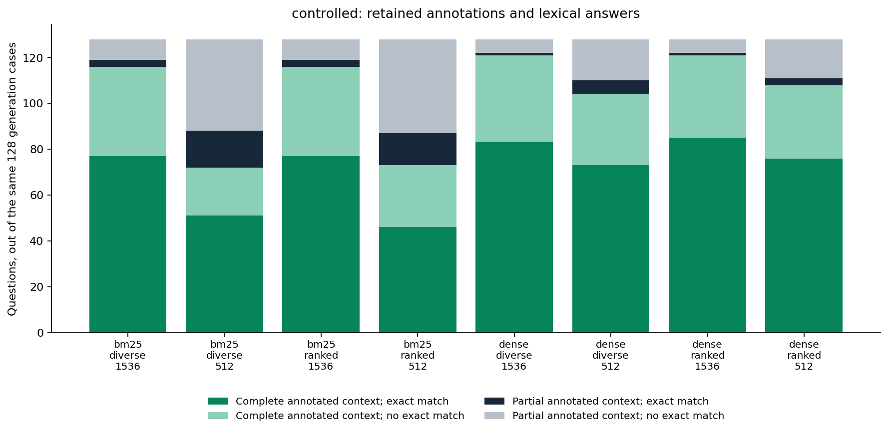
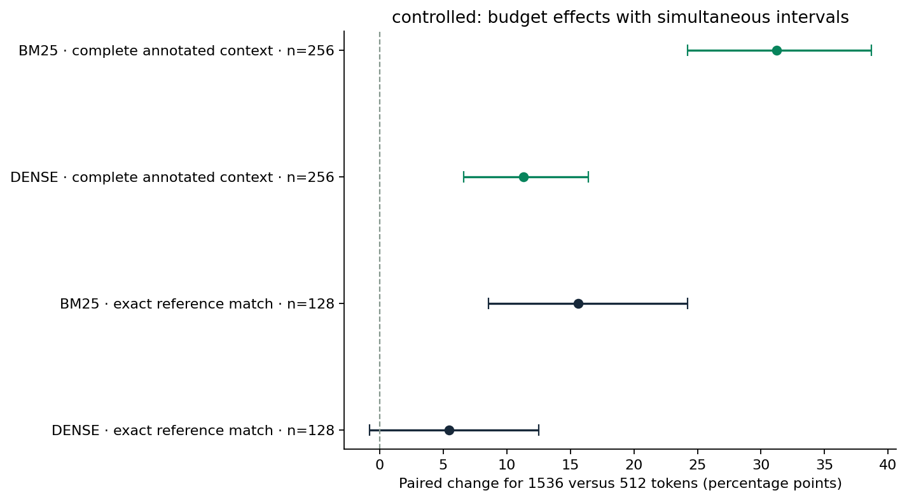
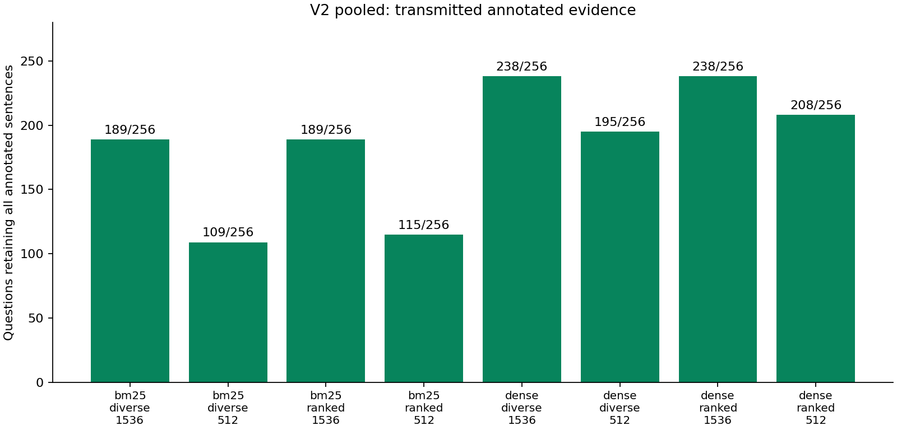

# Following evidence from retrieval to answer

A search system can find a useful passage without placing it in the text a language model actually reads. A model can also give a reasonable answer that fails a strict reference-string comparison. This study separates those two problems instead of interpreting one aggregate answer score as an explanation.

We follow the same questions through retrieval, context selection, and generation. The measurements below concern retained annotated sentences and lexical answer agreement. Factual correctness and documentary support have not been independently adjudicated.

## Experimental design

| Component | Questions | Purpose |
|---|---:|---|
| Exploratory cohort | 64 | Audit the existing eight-condition experiment and answer controls |
| Technical pilot | 8 | Check all eight requests per question, tokenization, output format, and truncation |
| Controlled preservation study | 256 | Compare retrieval and context selection without requiring generation |
| Controlled answer study | 128 of those 256 | Eight configurations each: 1,024 primary responses |
| Stability checks | 16 of those 128 | Two additional identical-request passes: 32 responses |
| Pooled-corpus study | The same 256 | Separate exploratory retrieval/context experiment; no generation arm |

The 256 cases contain 128 bridge and 128 comparison questions. The generation subset contains 64 of each. Selection was seeded and fixed before inspecting the answers. Pilot and confirmation questions reuse neither question IDs, normalized question texts, nor supporting-document titles from the exploratory cohort. The newly selected questions are mutually disjoint under those checks. This prevents direct support-document reuse; it does not eliminate common topics, shared distractors, or public-dataset pretraining exposure.

The controlled setting searches only the ten paragraphs supplied with each HotpotQA question. It is a controlled candidate-set experiment, not open-Wikipedia retrieval. Chunks contain three original sentences. We compare BM25 and dense retrieval, ranked and document-diverse packing, and budgets of 512 and 1,536 tokens. Retrieval and packing never receive answer references or supporting-fact flags.

The pinned Qwen generator, nomic embedding model, prompts, and generation settings are kept fixed. A context budget counts the fully rendered titles, sentence IDs, and separators. Whole chunks that do not fit are skipped. The technical pilot passed all 64 requests and the three tokenizer probes without using answer quality as a pass criterion.

## What the audit establishes

The audit reconstructed the 64 selected IDs, 128 retrieval rankings, and all 512 transmitted contexts and lexical scores. The original aggregates and paired bootstrap intervals reproduce. Raw observations, original annotations, and recorded scores are unchanged.

BM25 follows the documented bag-of-words formula; dense search uses cosine similarity of the preserved vectors. Annotated passage recall and annotated sentence coverage have different denominators. Token budgets are checked against the rendered context, and the archived user prompt must contain exactly that context. Annotations enter scoring and source validation, not ranking or selection.

The initial sample has 64 questions, not 512 independent observations. Shared supporting-document titles connect a few of those questions; the supplied cluster-bootstrap sensitivity analysis keeps that limitation visible. Its sixteen diagnostic controls are the first sorted question IDs, including ten comparison and six bridge questions. They are useful cases to inspect, not a representative estimate of factual accuracy.

### Why five exact matches out of sixteen is not an accuracy estimate

The gold-evidence controls give five exact reference matches out of sixteen. Neither that count nor a zero lexical score establishes semantic correctness. The supplied references, answers and contexts remain available for independent human rubric calibration. This diagnostic subset is not a representative accuracy sample.

The automated faithfulness proxy also rejects four of sixteen nominal positive controls. One of those controls asks which documentary was more successful without defining success or supplying comparable evidence. Its reference label cannot simply be assumed to establish entailment. The observed positive-control rate therefore does not calibrate the judge into a truth oracle.

## Controlled results

Context completeness uses all 256 questions. Answer scores use the fixed 128-question subset. The two denominators must not be compared as if they counted the same sample.

| Configuration | Complete annotated context /256 | Exact matches /128 | Explicit abstentions /128 | Invalid/failed outputs /128 | Mean lexical F1 |
|---|---:|---:|---:|---:|---:|
| bm25:diverse:1536 | 228 | 80 | 6 | 0 | 0.758 |
| bm25:diverse:512 | 144 | 67 | 24 | 0 | 0.629 |
| bm25:ranked:1536 | 228 | 80 | 6 | 1 | 0.759 |
| bm25:ranked:512 | 148 | 60 | 26 | 0 | 0.589 |
| dense:diverse:1536 | 249 | 84 | 9 | 0 | 0.778 |
| dense:diverse:512 | 203 | 79 | 14 | 0 | 0.739 |
| dense:ranked:1536 | 249 | 86 | 8 | 0 | 0.781 |
| dense:ranked:512 | 220 | 79 | 19 | 0 | 0.736 |

One invalid output remains in the denominator, without regeneration. A recorded response returns an answer and citation while setting `abstain=true`, violating the registered consistency instruction despite having valid JSON. This is an output-consistency failure. Explicit abstention counts above exclude invalid outputs; the unanswered composite includes both.

A complete annotated context and an exact answer match are separate outcomes. An exact match with partial annotated evidence can reflect sufficient alternative text, prior knowledge, or incomplete annotations. A zero exact match with complete annotated evidence can reflect generation, prompt constraints, reference wording, or source ambiguity. Neither flag identifies factual error on its own.

### Protocol-specified paired comparisons

Each difference compares the same questions. Intervals resample questions within type with 10,000 draws. The five preservation tests and four lexical/composite tests each use Holm correction. The intervals below are conservative simultaneous intervals within the corresponding family; all unadjusted intervals and individual gains/losses remain in the result data.

| Comparison | Outcome | Questions | Difference in percentage points [simultaneous interval] | Holm p |
|---|---|---:|---|---:|
| bm25:ranked:512 → bm25:ranked:1536 | complete_context | 256 | +31.2 [+24.2, +38.7] | 8.2718e-24 |
| dense:ranked:512 → dense:ranked:1536 | complete_context | 256 | +11.3 [+6.6, +16.4] | 1.1176e-08 |
| bm25:ranked:512 → bm25:diverse:512 | complete_context | 256 | -1.6 [-5.5, +2.0] | 0.42395 |
| dense:ranked:512 → dense:diverse:512 | complete_context | 256 | -6.6 [-11.3, -2.3] | 0.0004425 |
| bm25:ranked:512 → dense:ranked:512 | complete_context | 256 | +28.1 [+19.9, +37.1] | 3.3138e-13 |
| bm25:ranked:512 → bm25:ranked:1536 | answer_em | 128 | +15.6 [+8.6, +24.2] | 7.6294e-06 |
| bm25:ranked:512 → bm25:ranked:1536 | unanswered | 128 | -14.8 [-24.2, -6.2] | 0.00019813 |
| dense:ranked:512 → dense:ranked:1536 | answer_em | 128 | +5.5 [-0.8, +12.5] | 0.06543 |
| dense:ranked:512 → dense:ranked:1536 | unanswered | 128 | -8.6 [-15.6, -2.3] | 0.0068359 |

The unanswered composite includes explicit abstentions and execution/format failures; the preceding table keeps those counts separate. F1 and the other response contrasts are exploratory. A significant lexical change is not a demonstrated improvement in factual truth.

### Locate the annotated-information gaps

| Configuration | Retrieval misses some annotations /256 | Packing discards retrieved annotations /256 | Complete retrieval, incomplete context /256 | Complete context, zero exact match /128 |
|---|---:|---:|---:|---:|
| bm25:diverse:1536 | 28 | 0 | 0 | 39 |
| bm25:diverse:512 | 28 | 91 | 84 | 21 |
| bm25:ranked:1536 | 28 | 0 | 0 | 39 |
| bm25:ranked:512 | 28 | 87 | 80 | 27 |
| dense:diverse:1536 | 7 | 0 | 0 | 38 |
| dense:diverse:512 | 7 | 46 | 46 | 31 |
| dense:ranked:1536 | 7 | 0 | 0 | 36 |
| dense:ranked:512 | 7 | 30 | 29 | 32 |

These gap counts can overlap and must not be added to estimate independent failures. They locate annotated-information loss; they do not allocate every apparent answer failure to a unique cause.

### Results by question type

| Configuration | Bridge exact matches /64 | Comparison exact matches /64 |
|---|---:|---:|
| bm25:diverse:1536 | 40 | 40 |
| bm25:diverse:512 | 37 | 30 |
| bm25:ranked:1536 | 40 | 40 |
| bm25:ranked:512 | 30 | 30 |
| dense:diverse:1536 | 44 | 40 |
| dense:diverse:512 | 42 | 37 |
| dense:ranked:1536 | 45 | 41 |
| dense:ranked:512 | 40 | 39 |

This type breakdown is descriptive. Balanced types do not establish the distribution of questions in a customer corpus.

## Separate pooled-corpus experiment

The common corpus contains 2,547 distinct title/sentence-array paragraph versions and 4,259 three-sentence chunks, built from the 256 questions' supplied public paragraphs. All relevant annotated paragraphs are present by construction. Every query searches this complete shared index; its own ten paragraphs are not preselected at retrieval time. This creates more competition while retaining an intentionally restricted, question-derived corpus.

The following results are exploratory and are kept separate from the controlled experiment. They do not estimate unrestricted search or production behavior.

| Configuration | Mean passage Recall@10 | Complete annotated context /256 | Mean annotated-sentence coverage |
|---|---:|---:|---:|
| bm25:diverse:1536 | 0.875 | 189 | 0.874 |
| bm25:diverse:512 | 0.875 | 109 | 0.685 |
| bm25:ranked:1536 | 0.875 | 189 | 0.874 |
| bm25:ranked:512 | 0.875 | 115 | 0.703 |
| dense:diverse:1536 | 0.969 | 238 | 0.971 |
| dense:diverse:512 | 0.969 | 195 | 0.884 |
| dense:ranked:1536 | 0.969 | 238 | 0.971 |
| dense:ranked:512 | 0.969 | 208 | 0.910 |

Pooled document IDs are global and can consume more tokens than the controlled setting's short IDs. Comparisons between corpora therefore include identifier overhead as well as retrieval competition; comparisons within each environment keep that formatting fixed.

## Identical prompts and stability

Among the 2,048 prepared controlled requests, 422 groups have identical complete payloads across configuration labels. Of those groups, 206 contain at least two actually generated requests in the fixed answer subset. They are retained explicitly rather than credited as different model inputs. A changed answer under an identical request is generation variability, not a selection-policy effect.

| Actual answer-study comparison | Identical request pairs /128 | Changed exact score under an identical request |
|---|---:|---:|
| bm25:ranked:512 → bm25:ranked:1536 | 0 | 0 |
| dense:ranked:512 → dense:ranked:1536 | 0 | 0 |
| bm25:ranked:512 → bm25:diverse:512 | 87 | 2 |
| dense:ranked:512 → dense:diverse:512 | 62 | 0 |
| bm25:ranked:512 → dense:ranked:512 | 0 | 0 |

| Additional pass | Identical planned requests | Changed normalized answer/abstention | Changed citation set | Unusable comparison pairs |
|---|---:|---:|---:|---:|
| 1 | 16 | 0 | 0 | 0 |
| 2 | 16 | 0 | 0 | 0 |

These sixteen questions do not establish stability on every question or across models and machines. Temperature zero is not a proof of deterministic generation.

## Independent semantic validation

All 1,024 primary outputs require two independent human reviews. Phase one judges exact-context support, citation-only support, citation IDs and abstention justification without a reference answer. After both submissions are locked, phase two reveals references and complete original paragraphs for correctness and reference-adequacy judgements. A third independent human arbitrates categorical disagreements with reasons.

[The annotation guide](v2/ANNOTATION.md) and executable workflow generate separately randomized packets, keep mapping keys outside the public repository, enforce phase release, preserve both independent submissions and report agreement before arbitration. Null templates are not annotations. The semantic family remains unavailable until the complete agreed/adjudicated labels exist; lexical matches and automatic judges never fill missing human decisions.

## What can be said in the article

**Supported by the measurements:** retrieval and context selection are distinct points of annotated-evidence loss. The same top-ten results can produce different retained evidence under a changed budget or packing policy. The tables quantify those changes on the fixed cohort, including negative outcomes.

**Conditional observations:** the answer study measures lexical agreement, F1, abstention, and execution failure for one quantized model and the registered settings. Paired estimates and their uncertainty describe those outcomes; they do not identify a universally better retriever or establish that retaining more annotations causes more truthful answers.

**Still open:** semantic correctness, whether the exact cited or transmitted text supports each answer, and the share of true answer failures attributable to generation versus evaluation. The controls show why a zero lexical score cannot answer those questions. There is no independently adjudicated semantic result to substitute for that missing measurement.

## Limits

The sample is English, public, balanced by type, and selected with document-disjoint eligibility rules. A public pretrained model may already know some questions. All primary generation results use one local model and workstation. Replaying cached vectors, packing, and scoring checks calculations; it does not repeat model generation on independent hardware. Host timing records are not a qualified latency, throughput, energy, or cost benchmark.

The approximate power scenarios are in [the sampling data](v2/data/power-planning.json). Under the stated 10–50% discordance assumptions and conservative alpha .01, the 80%-power detectable differences are roughly 9.6–21.4 percentage points at 128 questions and 6.8–15.1 at 256. These are planning assumptions, not observed power. Small response effects can remain inconclusive after multiplicity correction. Failure to reject a null is not evidence of equivalence. No production or financial claim follows from either corpus.

HotpotQA-derived data retains attribution to Yang, Qi, Zhang et al., EMNLP 2018, and its CC BY-SA 4.0 license. Code and original evaluator licensing are preserved in the repository.
